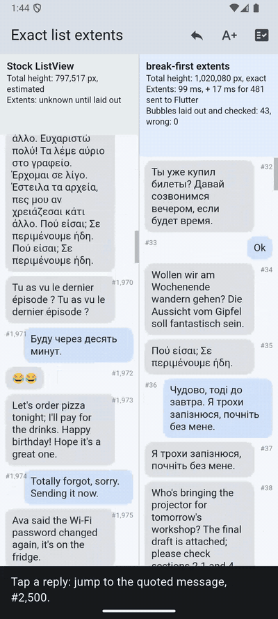

# Break Before You Shape

Exact line breaking from a precompiled, certified width model: line breaks and paragraph heights computed **before**
any text shaping, and identical to what the text engine produces.

Paper: [paper/paper.pdf](paper/paper.pdf) ([HTML](paper/paper.html)). Longer research notes: [RESEARCH.md](RESEARCH.md).
Flutter package: [packages/break_first](packages/break_first).



A chat list of 10,000 messages on the Android emulator, release build ([video](media/list_extents_android.mp4)).
The stock `ListView` asked for #2,500 lands on #1,969, in a 717 ms frame. With break-first extents it lands on #2,500
in a 22 ms frame. All 10,000 extents equal `TextPainter`'s ([measured log](media/list_extents_android_measured.txt)).

## The idea

Text engines shape a paragraph (HarfBuzz) before they can break it into lines. This project compiles a font's shaping
behaviour into a small per-font model by **measuring the shaper as a black box**: every character, every pair, every
ligature island next to each safe neighbour. A **static analysis of the font's layout tables** (GSUB, GPOS, GDEF, `morx`,
`kern`, `kerx`) proves on which lines the model's width equals the shaped width. Lines are then broken from the model
alone. Anything the breaker cannot certify goes back to the engine.

## Results

Measured on one Apple M3 machine (macOS, an iOS 17.5 simulator, an Android API 35 emulator) and on GitHub Actions.
Every number in the paper is generated from the files in `results/`, `census/` and `flutter_bench/results/`.

| | |
|---|---|
| Font census: 449 local font faces | 5,339,408 of 5,560,372 lines certified (96%), **0 wrong**; 410 faces certify ≥ 99% of lines |
| Flutter, macOS release: line breaks and heights vs Flutter's own layout | **2,524,902 of 2,524,902** paragraph layouts identical (7,201,290 lines; 9 corpora, 6 languages, 6 font sizes, 12 widths); 0.87% handed back to Flutter |
| Same sidecar on the iOS simulator / Android emulator | 192,193 of 192,193 / 192,176 of 192,176 identical |
| On GitHub Actions: Linux, macOS, iOS simulator, Android emulator ([run](flutter_bench/results/ci/run-41614792200)) | **5,529,364** layouts identical, 0 different |
| Letter and word spacing, height multiplier, `maxLines`, hard line breaks (macOS release) | **4,575,628** layouts identical, 0 different |
| Hebrew and Arabic (alone and mixed with Latin), Japanese, Chinese, Korean; Arial, Times New Roman, Hiragino Sans GB, Apple SD Gothic Neo | **1,357,183** layouts identical, 0 different; the other 946,745 handed to Flutter |
| Speed vs `TextPainter` (macOS release, median of 3 runs) | **18.5×** (docs), **25.2×** (chat); re-wrap at a new width 11.6× / 9.6× |
| Speed on GitHub Actions (docs / chat) | 26.0× / 27.6× macOS (virtual M1), 18.9× / 24.7× Linux, 24.5× / 38.6× Android emulator |
| C port of the breaker through `dart:ffi` | same line starts in all 2,552,760 checks; 2.0× / 2.3× faster than the Dart breaker, so the package stays in Dart |
| Exact heights for a 24,000-message chat list | 33 ms vs 588 ms (18.0×); every height equal |
| Sidecar for Roboto (Latin, Greek, Cyrillic) | 590,712 bytes, 10,553 gzipped, one file for every font size and style option |
| Today's shortcuts vs exact ground truth (HarfBuzz) | shape once then break: up to 1.2% of paragraphs wrong; per-word cache: up to 9.6% |

## Layout

| Path | What |
|---|---|
| `certify.py` | Static certificate: classifies every character S / P / K / U from the font's tables (fontTools) |
| `bfl.c` | C prototype: distillation, breaker, island-table checker, HarfBuzz baselines |
| `census.py`, `census_reasons.py` | Census over every local font face, and what blocks the rest |
| `font_census.py` | Prepares the Flutter font census (`flutter_bench/test/font_census_test.dart`) |
| `make_corpus.py`, `make_corpora.py` | Corpora from local files (not shipped: see below) |
| `packages/break_first/` | The Flutter package: breaker and width model, sidecar build step, tests, and the list-extents example |
| `flutter_bench/` | Benchmark app on the package: sidecar build (`test/build_sidecar_test.dart`), validation and timing harness (`lib/bench.dart`), right-to-left and CJK checks (`test/rtl_test.dart`, `test/script_test.dart`, `tool/*_check.sh`) |
| `native/` | C port of the breaker, called through `dart:ffi` in the benchmark (`flutter_bench/lib/native.dart`) |
| `.github/workflows/` | `ci.yml` (tests on every push), `bench.yml` (the benchmarks on Linux, macOS, iOS simulator and Android emulator) |
| `media/` | The list-extents demo video, and the numbers it measured |
| `paper/` | `make_figures.py` (figures and every number), `build_paper.py` (fills the template, prints the PDF) |
| `results*.txt`, `census/`, `flutter_bench/results/` | Raw results |

## Reproduce

```sh
# C prototype and census (needs HarfBuzz and fontTools)
clang -O3 -I$(brew --prefix harfbuzz)/include/harfbuzz -L$(brew --prefix harfbuzz)/lib -lharfbuzz bfl.c -o bfl
python3 census.py 6

# Flutter: corpora, sidecar, exactness, timing
cd flutter_bench
tool/prepare_assets.sh
flutter test test/build_sidecar_test.dart
flutter test test/validate_host_test.dart
flutter build macos --release --dart-define=BF_MODE=all
BF_OUT=$PWD/results/macos_release.json build/macos/Build/Products/Release/bf_bench.app/Contents/MacOS/bf_bench

# Paper
cd ../paper && python3 make_figures.py && python3 build_paper.py
```

The benchmarks also run on GitHub Actions, free on a public repository:

```sh
gh workflow run bench.yml
```

## Notes

- The corpora are extracted from this machine's files: Python docstrings, macOS man pages, licence texts and macOS
  localized UI strings (on Linux runners: gettext catalogs, man pages and licences). They are not redistributed here; `flutter_bench/tool/prepare_assets.sh` regenerates them.
  System fonts are not included either. The census reads them in place.
- `flutter_bench/assets/Roboto-Regular.ttf` is Roboto, under the Apache License 2.0 (`Roboto_LICENSE.txt`).
- The macOS benchmark app has the app sandbox disabled, so it can write its results file.
- Scope: Latin, Greek, Cyrillic, Hebrew, Arabic, Chinese, Japanese and Korean, in either direction, with one font and
  size per paragraph. Indic and Southeast Asian scripts, vowel marks, emoji, characters a font lacks, letter-spaced
  Arabic and rich text go to Flutter. Mobile timings come from simulators and emulators, not phones.
