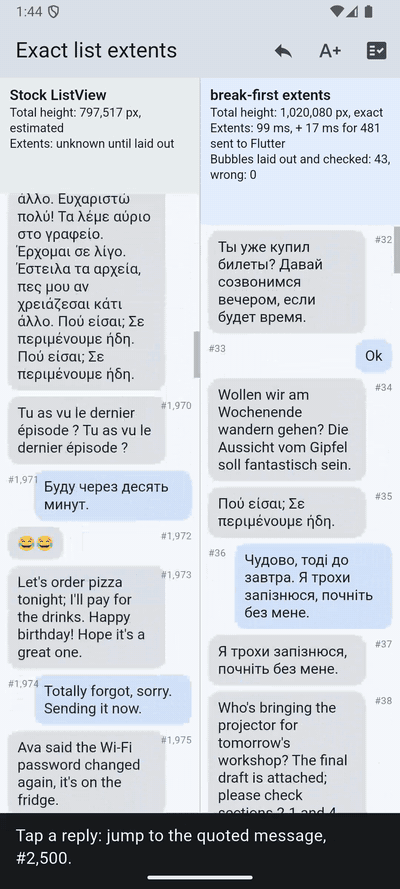

# break_first

Exact line breaks and paragraph heights for Flutter, computed **before** shaping, from a small per-font file
(the *sidecar*) built once at build time. When it can't be sure, it hands the paragraph back to Flutter, so its
answers equal Flutter's own layout.



The [example](example/) is a chat list with 10,000 messages. A stock `ListView` (left) learns heights only by laying
items out, so it can only estimate where message #2,500 is. It also has to lay out every message between the current
position and the target. With extents from break-first (right), the list knows every height and its total height before
anything is laid out. Android emulator, release build, one run ([full video](../../media/list_extents_android.mp4),
[measured log](../../media/list_extents_android_measured.txt)):

| | Stock `ListView` | break-first extents |
|---|---|---|
| Jump to #2,500 | lands on #1,969, 717 ms frame | lands on #2,500, 22 ms frame |
| Jump back to #300 | lands on #246, 724 ms frame | lands on #300, 19 ms frame |
| Total height | estimated, changes while scrolling | exact |
| All 10,000 extents | — | 99 ms (+17 ms for 481 messages sent to Flutter); TextPainter: 444 ms |

Every bubble the right-hand list lays out is checked against its predicted height. At the end, all 10,000 extents are
checked against `TextPainter`: 10,000 of 10,000 equal.

## Use

```dart
final bytes = (await rootBundle.load('assets/roboto.bfw')).buffer.asUint8List();
final bf = BreakFirst.load(bytes, fontFamily: 'RobotoSidecar'); // null if this device's font differs

final h = bf!.height(text, fontSize: 16, maxWidth: 280);          // always equal to Flutter's height
final starts = bf.lineStarts(text, fontSize: 16, maxWidth: 280);  // null when Flutter must decide

// Re-wrapping one paragraph at many widths or sizes: prepare once.
final p = bf.prepare(text);
p?.lineCount(fontSize: 16, maxWidth: 320);
```

Lay the text out with `bf.style(fontSize)` (plus a colour) and `TextScaler.noScaling`; pass the scaled size yourself.
`BreakFirst.load` checks the sidecar against this device's text engine: it calibrates how the engine rounds font sizes
(Android truncates them to 1/64 px) and measures five canary strings. It returns null if any width is off.

## Build a sidecar

1. Certify the font's layout tables: `python3 certify.py MyFont.ttf myfont.cert 4` (from the repository root; needs
   fontTools).
2. Under `flutter test`, load the font and distil the sidecar by measuring Flutter's own text stack:

```dart
final font = File('assets/MyFont.ttf').readAsBytesSync();
await (FontLoader('MyFont')..addFont(Future.value(ByteData.sublistView(font)))).load();
final md = buildSidecar(fontFamily: 'MyFont', font: font, certificate: File('myfont.cert').readAsStringSync());
File('assets/myfont.bfw').writeAsBytesSync(md.encode());
```

For Roboto this takes 614,675 layouts and about 9 s, and gives 573,104 bytes (10,357 gzipped). One file serves every
font size. The package tests rebuild Roboto's sidecar on the machine running them and require the exact bytes that ship.

## Tests

`flutter test` checks, on whatever engine runs it:

- the sidecar round-trips;
- Flutter's float32 line-fit rule;
- break opportunities;
- the canary;
- that rebuilding the sidecar gives the shipped bytes;
- that 43,200 layouts of generated multilingual text break and measure exactly as Flutter does.

On macOS: 0 different, 1,190 sent to Flutter, all heights equal. CI runs them on Linux and macOS.

## Scope

Single-style, left-to-right paragraphs in Latin, Greek and Cyrillic, with the default style: no letter or word spacing,
no height multiplier, no font features and no `maxLines`. Anything else goes to Flutter. See the
[paper](../../paper/paper.pdf) for the method and its proofs.
